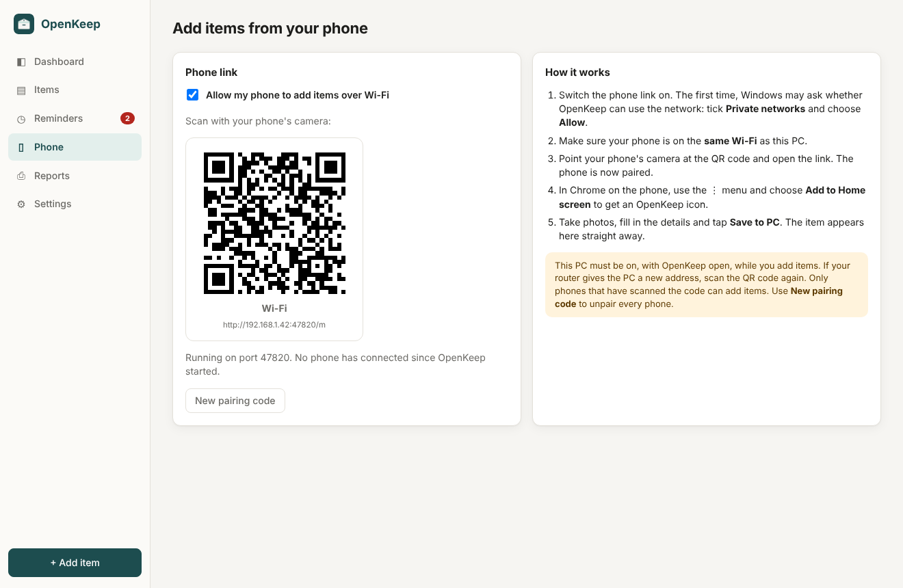

# OpenSafe

Free home inventory and asset manager for Windows. Record what you own: photos, receipts, serial numbers, warranties, insurance and service history. Add items from your phone or tablet with OpenSafe Capture.

Everything stays on your PC. There's no account, no cloud and no subscription.


## Features

- **Items:** name, category, location, brand, model, serial number, condition, status (owned, lent out, in repair, sold, disposed, lost/stolen), purchase date and price, supplier, current value, warranty end date, insurer, policy number, insured value, tags and notes.
- **Photos and documents:** drag in photos, receipts, manuals and warranty cards (PDF, images, Office files). Choose a cover photo and click any photo to enlarge it.
- **Vehicles and boats:** registration, VIN/frame number, engine number, mileage, MOT, road tax and service dates for cars, vans and motorbikes. Hull ID, registration, MMSI, call sign, engine hours and mooring for boats. MOT, tax and service dates come with reminders.
- **Lending and selling:** who has an item and when it's due back (with a reminder), or the sale date, price and buyer.
- **Insurance policies:** record each policy once (insurer, number, renewal date, premium, excess, cover limit, claims line), link the items it covers, and get a reminder before renewal.
- **Automatic backups:** a full backup, photos included, made daily, weekly or monthly to a folder such as OneDrive or a USB stick, keeping the newest few.
- **Dark mode:** light, dark, or match Windows.
- **Service log:** MOTs, services, repairs, batteries and inspections, with cost, mileage and a "next due" date.
- **Reminders:** warranty end dates and next-due service dates, looking ahead a number of days you choose, plus a Windows notification at start-up for anything due within 7 days.
- **Dashboard:** total value, amount paid, insured value, value by category, what's coming up, and gaps to fill (no serial number, no receipt, no insurer, no photo).
- **Change many items at once:** tick items in the list and choose **Change…** to set their location, category, status (with who has them or who bought them) or insurance policy in one go.
- **Search:** finds items by name, brand, model, serial number, barcode, registration, VIN, hull ID, who has it (name or phone/email), insurer, policy number and notes.
- **Rooms within locations:** write a location as a path, such as *Home / Garage / Shelf 2*. Choosing *Home / Garage* in Items includes everything on its shelves, and the dashboard shows a count and value for each place. The phone's stock check works the same way.
- **Item sets:** on an item's page, **Add parts…** groups the things that go with it (a drill's batteries and charger, a boat's tender and outboard). Each part keeps its own details; the set shows its total value, and a claim pack for the main item includes its parts.
- **Value over time:** each change to an item's value is recorded with the date, and you can add valuations (for example from a jeweller). In **Settings → Value drop per year** you can set a percentage per category; items with no value entered then get an estimate from the price paid and how long you've had them. Estimates are used on the dashboard and item pages, not in claim packs or reports.
- **Import from a spreadsheet:** **Import Files → Import from a spreadsheet** reads a CSV file (save it from Excel as *CSV UTF-8*), suggests which column is which, reads UK dates and £ prices, and skips rows already in OpenSafe. OpenSafe's own CSV export imports back the same way.
- **Insurance claim pack:** select items, or use the button on an item, to get one PDF for your insurer. It has a cover page with the incident details and totals, then every photo, serial numbers, purchase details and receipt photos for each item. Receipt PDFs are added at the end.
- **Receipt reading:** click **Read receipt** on a receipt photo to fill in the shop, date and price paid. It uses Tesseract OCR and runs offline on your PC, so nothing is uploaded.
- **Reports:** a printable PDF inventory for your insurer, with photos, and a CSV export for Excel.
- **Password protection and vault:** AES-256 encryption of everything, a recovery key, and a PIN-protected vault for sensitive items and files.
- **Backups:** a copy of your item list every day, kept for 30 days, plus a full backup (with photos and documents) to any folder or USB stick, and restore.
- **OpenSafe Capture:** an offline phone and tablet app for adding items with photos, imported on the PC from one file.
- **Inventory on your phone:** a read-only, passphrase-encrypted copy of your PC inventory you can search on your phone.
- **QR labels:** print A4 sheets of 21 labels (63.5 × 38.1 mm, Avery L7160 size). Scanning a label on the phone opens that item. Print one label from an item's page with **QR label…**.
- **Scan a label to update an item:** in Capture, tap **Scan an item's QR label** to move it, lend it (with the person's phone or email and a due-back date), mark it returned, needing repair, in repair, repaired, sold, lost or got rid of, or add a note. The changes go to the PC in your next export.
- **Barcodes:** scan a product barcode with the phone camera, or type it in. On the PC, **Look up** fills in the product name and brand from UPCitemdb (free, about 100 lookups a day and 6 a minute, needs the internet).

## Password protection and the vault

**Settings → Password protection** encrypts everything OpenSafe stores: the item list, photos, documents and daily backups.

- **Encryption:** files are encrypted with AES-256-GCM using a random master key. The master key is stored only in wrapped form, encrypted with a key derived from your password (scrypt, N=2¹⁷).
- **Asking for the password:** OpenSafe asks for it every time it opens. **🔒 Lock OpenSafe** locks it straight away. Five wrong passwords in a row add a 30-second wait, which doubles each time.
- **Recovery key:** when you turn protection on, you get a 24-character recovery key, shown once. It resets a forgotten password or vault PIN. **If you lose both the password and the recovery key, the data can't be recovered.**
- **Turning it off:** protection can be turned off, which decrypts everything again, or the password changed. A new recovery key can be made at any time, and the old one then stops working.

**The vault** is a second layer, opened with a separate 4–8 digit PIN:

- **What goes in:** move a whole item into the vault, or put single photos and documents in it, such as an ID scan or a V5C logbook.
- **Separate key:** vault items and files are encrypted with their own key, which is unlocked by the PIN or the recovery key.
- **While locked:** vault items are hidden and left out of totals, reminders, reports and CSV exports. Vault files show only as "Vault file".
- **Locking:** the vault locks when OpenSafe locks or closes, or with **Lock vault**.

Notes:
- Photos are decrypted in memory to show them. A document you open is decrypted into a private temporary folder, which is deleted when OpenSafe locks or closes.
- PDF reports and CSV exports are saved unencrypted, because they're meant for sharing.
- A full backup to a folder stays encrypted. Restoring an encrypted backup needs the password that was in use when the backup was made.
- Protection guards against someone reading your files, for example from a stolen laptop or a copied backup. It can't protect against malware running on your PC while OpenSafe is unlocked.

## Adding items from your phone or tablet: OpenSafe Capture

OpenSafe Capture is a small app for your phone or tablet that works offline. You add items with photos, details and receipts, then export them all as one `.opensafe` file to import on the PC. It needs no Wi-Fi link, firewall changes or account, and nothing leaves the device until you export.

1. On your phone, open **https://guestymark-spr.github.io/OpenSafe/** in Chrome, or scan the QR code on OpenSafe's **Import Files** screen. Tap **Install** (or ⋮ → **Add to Home screen**).
2. Add items. They're saved on the device.
3. Tap **Export to PC**. Send the file with Quick Share, Bluetooth, email, Google Drive or OneDrive, or save it to Downloads and copy it over USB.
4. On the PC, click **Import from phone…**, double-click the `.opensafe` file, or drag it into the OpenSafe window.

Importing the same file twice is safe. Items already imported are skipped, details you edited on the PC are kept, and only new photos or receipts are added.

### Updating items by scanning their labels

Tap **📷 Scan an item's QR label** on the **Add & export** tab (or scan the label with the phone's camera app). Choose what happened: moved, lent, back, needs repairing, gone for repair, repaired, sold, lost or stolen, got rid of, or a note. Changes wait on the phone (tap one to undo it) and go into the next **Export to PC**.

When you import the file on the PC:
- each change is applied once, in the order you made them, and added to the item's notes with the date, so the notes keep a history of moves and loans;
- a change is skipped, and listed in the import summary, if you edited that item on the PC after making the change on the phone;
- an export with changes needs OpenSafe 1.6 or later on the PC.

### Photos and receipts for items you already have

After scanning a label, **📷 Add photos** or **🧾 Add a receipt** (a photo or PDF) adds them to that item on the PC at the next import. They're added even if you've edited the item on the PC since, because adding a photo can't overwrite anything. This needs OpenSafe 1.8 or later on the PC.

### Stock check

Tap **📋 Stock check**, choose a place (for example Garage), and scan every label you can find. The camera stays on between labels. At the end you'll see:
- what's in the wrong place, with a button to record it as moved there;
- what wasn't found;
- what's lent out;
- what's where it should be;
- any labels that aren't in the inventory copy on the phone.

It uses the inventory copy on the phone plus any changes waiting to export, so load a recent inventory file first.

### Your inventory on the phone

On the PC, go to **Import Files → See your inventory on your phone**, choose a passphrase (at least 6 characters) and click **Save inventory for phone…**. Send the `.opensafe-view` file to the phone the same way as an export, then in Capture open **My inventory**, load the file and enter the passphrase.

- **Encryption:** the file is encrypted with AES-256-GCM using a key from your passphrase (PBKDF2-SHA256, 310,000 rounds). You enter the passphrase once per file: after that the phone keeps the unlock key in the app's storage (as a non-extractable Web Crypto key; the passphrase itself isn't stored), so it opens straight away. **⋮ → Lock inventory** removes the key so it asks again. Anyone who can unlock your phone and open Capture can see the inventory, so keep a screen lock on the phone.
- **Read-only:** it's a copy with small photos and the main details. Make a new file whenever you want the phone up to date. Vault items are left out unless you tick **Include vault items** while the vault is open.
- **Labels:** **Scan label** (or the phone's camera app) opens the item a QR label belongs to.

Camera scanning uses the browser's BarcodeDetector, which Chrome on Android supports. If a browser lacks it, type the number in.

The app is an installable web app (PWA) served from the `mobile/` folder through GitHub Pages. It stores items in the browser's IndexedDB on the device.

## Wi-Fi link (advanced)



OpenSafe can also run a small web server on your home network, so a phone on the same Wi-Fi can add items straight to the PC. It's off until you switch it on under **Phone → Wi-Fi link**, and it needs the pairing code from the QR code. Some routers and phone browsers block this kind of connection. The Phone screen has a **Fix Windows Firewall** button and a connection log to help you sort it out.

## Install

Download `OpenSafe-Setup-x.y.z.exe` from [Releases](../../releases), or from the latest run under **Actions → Build Windows app → Artifacts**. The app isn't code-signed, so Windows SmartScreen may warn you: choose **More info → Run anyway**.

### Automatic updates

The installed version checks GitHub for a new release when it starts and every 4 hours. It downloads updates quietly in the background, then shows a **Restart now** bar. If you choose **Later**, the update installs the next time you close OpenSafe. Your items, photos and settings are kept. Check for updates yourself under **Settings → Updates**.

The portable exe and the zip can't update themselves, so use `OpenSafe-Setup` to get updates.

Your data is saved in `%APPDATA%\OpenSafe\data`. **Settings → Open data folder** opens it.

## Build it yourself

```bash
npm install
npm start          # run in development
npm test           # data and phone-link tests
npm run dist:win   # installer + portable exe (run on Windows)
```

Every push to `main` builds the Windows installer through GitHub Actions. If the `version` in `package.json` hasn't been released yet, the build is also published as a GitHub release (tag `v<version>`), and installed copies update themselves.

To release an update:

```bash
npm run release:patch   # 1.0.0 -> 1.0.1 (fixes)
npm run release:minor   # 1.0.1 -> 1.1.0 (new features)
```

Or just change `version` in `package.json` and push. The repo must be public for the app to see releases.

## Project layout

```
src/main.js         Electron main process: window, file dialogs, PDF/CSV export, IPC
src/preload.js      Safe bridge between the window and the main process
src/store.js        Data store (JSON file + attachments folder, daily backups, encryption, vault)
src/secure.js       Encryption primitives (AES-256-GCM, scrypt, recovery key, X25519)
src/phoneServer.js  Wi-Fi phone link (token-protected local web server)
src/report.js       Insurance/inventory PDF layout
src/renderer/       Desktop UI (plain HTML/CSS/JS)
src/phone/          Phone page for the Wi-Fi link
mobile/             OpenSafe Capture phone/tablet app (published to GitHub Pages)
test/               Unit tests and a screenshot smoke test
```

MIT licence.
