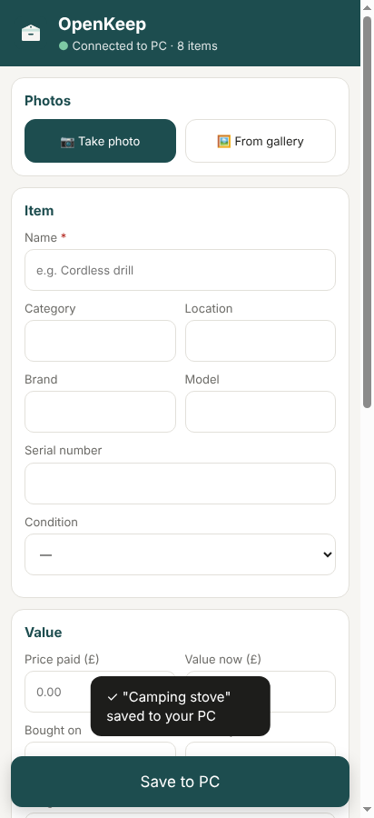

# OpenSafe

Free home inventory and asset manager for Windows. Record what you own: photos, receipts, serial numbers, warranties, insurance and service history. Add items from your Android phone over Wi-Fi.

Everything stays on your PC. There's no account, no cloud and no subscription.


## Features

- **Items:** name, category, location, brand, model, serial number, condition, status (owned, lent out, in repair, sold, disposed, lost/stolen), purchase date and price, supplier, current value, warranty end date, insurer, policy number, insured value, tags and notes.
- **Photos and documents:** drag in photos, receipts, manuals and warranty cards (PDF, images, Office files). Choose a cover photo and click any photo to enlarge it.
- **Service log:** MOTs, services, repairs, batteries and inspections, with cost, mileage and a "next due" date.
- **Reminders:** warranty end dates and next-due service dates, looking ahead a number of days you choose, plus a Windows notification at start-up for anything due within 7 days.
- **Dashboard:** total value, amount paid, insured value, value by category, what's coming up, and gaps to fill (no serial number, no receipt, no insurer, no photo).
- **Reports:** a printable PDF inventory for your insurer, with photos, and a CSV export for Excel.
- **Backups:** a copy of your item list every day, kept for 30 days, plus a full backup (with photos and documents) to any folder or USB stick, and restore.
- **Phone link:** add items from your Android phone, with photos taken by the phone's camera.

## Phone link

 

1. In OpenSafe, open **Phone** and switch the link on. The first time, Windows Firewall asks whether OpenSafe can use the network. Tick **Private networks** and choose **Allow**.
2. Put your phone on the same Wi-Fi as the PC.
3. Scan the QR code with the phone's camera and open the link. The phone is now paired.
4. In Chrome, open the ⋮ menu and choose **Add to Home screen** to get an icon.
5. Take photos, fill in the details and tap **Save to PC**. The item appears on the PC straight away.

How it works: OpenSafe runs a small web server on your home network (port 47820, or the next free port up to 47829). It is off until you switch it on. Every request needs the secret pairing code from the QR code. **New pairing code** unpairs every phone. Phone photos are shrunk to 2000 px before they're sent.

Limits: the PC must be on, with OpenSafe open, and on the same network as the phone. If your router gives the PC a new IP address, scan the QR code again. To avoid this, reserve an IP address for the PC in your router settings. The connection is plain HTTP on your local network, so only use the link on a network you trust, such as your home Wi-Fi, not public Wi-Fi.

## Install

Download `OpenSafe-Setup-x.y.z.exe` from [Releases](../../releases), or from the latest run under **Actions → Build Windows app → Artifacts**. The app isn't code-signed, so Windows SmartScreen may warn you: choose **More info → Run anyway**.

### Automatic updates

The installed version checks GitHub for a new release when it starts and every 4 hours. It downloads updates quietly in the background, then shows a **Restart now** bar. If you choose **Later**, the update installs the next time you close OpenSafe. Your items, photos and settings are kept. Check for updates yourself under **Settings → Updates**.

The portable exe and the zip can't update themselves, so use `OpenSafe-Setup` to get updates.

Your data is saved in `%APPDATA%\OpenSafe\data`. **Settings → Open data folder** opens it.

## Build it yourself

```bash
npm install
npm start          # run in development
npm test           # data and phone-link tests
npm run dist:win   # installer + portable exe (run on Windows)
```

A push to `main` builds the Windows installer through GitHub Actions (under Artifacts) without releasing it.

To release an update to every installed copy:

```bash
npm run release:patch   # 1.0.0 -> 1.0.1 (fixes)
npm run release:minor   # 1.0.1 -> 1.1.0 (new features)
```

Each command bumps the version, makes a `v…` tag and pushes it. GitHub Actions then builds the installer and publishes the release with `latest.yml`, which installed apps use to find the update. The repo must be public for the app to see releases.

## Project layout

```
src/main.js         Electron main process: window, file dialogs, PDF/CSV export, IPC
src/preload.js      Safe bridge between the window and the main process
src/store.js        Data store (JSON file + attachments folder, daily backups)
src/phoneServer.js  Wi-Fi phone link (token-protected local web server)
src/report.js       Insurance/inventory PDF layout
src/renderer/       Desktop UI (plain HTML/CSS/JS)
src/phone/          Phone page served to your Android phone
test/               Unit tests and a screenshot smoke test
```

MIT licence.
