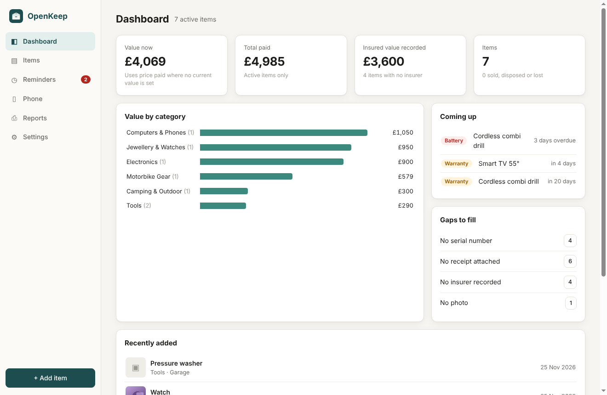

# OpenSafe

Free home inventory and asset manager for Windows. Record what you own: photos, receipts, serial numbers, warranties, insurance and service history. Add items from your phone or tablet with OpenSafe Capture.

Everything stays on your PC. There's no account, no cloud and no subscription.



## Finding your way

The menu on the left is grouped by job:

- **Home** (totals, what's coming up, gaps to fill, places, recalls) and **Reminders**.
- **Inventory:** **Items**, **Documents** (scanned letters and important papers), **Data** (saved emails, PDFs, Word files, photos and anything else), **Places** (every room, shelf and box with what's in it, its photos and videos, and its label) and **Packing lists**.
- **Protection:** **Insurance** and the **Vault**.
- **Tools:** **Reports & printing**, **Phone app**, **Import & backup** and **Help and what's new**.
- **Settings**, **Lock OpenSafe** (when password protection is on) and **+ Add item** sit at the bottom.

**Help and what's new** (under Tools) lists what changed in recent versions, and has a short checklist for trying the newest features on your own PC and phone, with ticks, notes and **Copy results**. After an update, Home shows a one-line note with a link to it.

**+ New** at the bottom of the menu adds an item, a document, Data files, a packing list or an insurance policy from any page.

The search box at the top of the menu (**Search everything…**) searches items, Documents and Data from any page, including the words inside letters, emails and the receipts and manuals attached to items. Results are grouped, with the matching words highlighted; **Show in Items**, **Show in Documents** or **Show in Data** carries the search across. Filters on Items, Documents and Data are drop-down chips (**Category ▾**, **Place ▾**, **Status ▾**, **Sort ▾**); **×** on a chip clears it. Less-used page actions (duplicates, deleted items, import and export, printing) are under **More ▾**.

**Right-click** an item, a document or Data entry, a file or a place for the things you can do with it (open, edit, move, link, duplicate, print a label, delete).

**Moving things:**
- **Items to a place:** tick several items and use **Move to ▾**, right-click → **Move to a place…**, or drag items (one, or all the ticked ones): a panel of your places appears, and you drop them on one. Item rows on the Places page can be dragged too. **New place…** makes a new one.
- **Between Documents and Data, and into Data folders:** tick entries and use **Move to ▾**, right-click, or drag them onto the panel that appears. A document moved to Data and back keeps its type.
- **Linking documents to items:** right-click a document → **Link to an item…**, or on an item's page use **+** in **Linked documents and files**. A linked letter, manual or email stays where it is and also shows on the item's page. **×** unlinks it (nothing is deleted).

On an item's page, **Edit** and **Log service** are always shown; less-used actions (duplicate, QR label, claim pack, sell, vault, delete) are under **More**.

## Features

- **Items:** name, category, location, brand, model, serial number, condition, status (owned, lent out, in repair, sold, disposed, lost/stolen), purchase date and price, supplier, current value, warranty end date, insurer, policy number, insured value, tags and notes.
- **Photos and documents:** drag in photos, receipts, manuals and warranty cards (PDF, images, Office files). Choose a cover photo and click any photo to enlarge it.
- **Documents and Data:** keep letters, papers, emails and files that aren't tied to one item, and search the words inside them (see below).
- **Vehicles and boats:** registration, VIN/frame number, engine number, mileage, MOT, road tax and service dates for cars, vans and motorbikes. Hull ID, registration, MMSI, call sign, engine hours and mooring for boats. MOT, tax and service dates come with reminders.
- **Lending and selling:** who has an item and when it's due back (with a reminder), or the sale date, price and buyer.
- **Insurance policies:** record each policy once (insurer, number, renewal date, premium, excess, cover limit, claims line), link the items it covers, and get a reminder before renewal.
- **Automatic backups:** a full backup, photos included, made daily, weekly or monthly to a folder such as OneDrive or a USB stick, keeping the newest few.
- **Dark mode:** light, dark, or match Windows.
- **Service log:** MOTs, services, repairs, batteries and inspections, with cost, mileage and a "next due" date.
- **Reminders:** warranty end dates and next-due service dates, looking ahead a number of days you choose, plus a Windows notification at start-up for anything due within 7 days.
- **Home page:** total value, amount paid, insured value, value by category, what's coming up, and gaps to fill (no serial number, no receipt, no insurer, no photo).
- **Change many items at once:** tick items in the list and choose **Change…** to set their location, category, status (with who has them or who bought them) or insurance policy in one go.
- **Search:** finds items by name, brand, model, serial number, barcode, registration, VIN, hull ID, who has it (name or phone/email), insurer, policy number and notes, and by the words inside the receipts, invoices and manuals attached to them (the row shows *In file: …* with the words found).
- **Rooms within locations:** write a location as a path, such as *Home / Garage / Shelf 2*. Choosing *Home / Garage* in Items includes everything on its shelves, and **Places** shows a count and value for each place. The phone's stock check works the same way.
- **Item sets:** on an item's page, **Add parts…** groups the things that go with it (a drill's batteries and charger, a boat's tender and outboard). Each part keeps its own details; the set shows its total value, and a claim pack for the main item includes its parts.
- **Value over time:** each change to an item's value is recorded with the date, and you can add valuations (for example from a jeweller). In **Settings → Value drop per year** you can set a percentage per category; items with no value entered then get an estimate from the price paid and how long you've had them. Estimates are used on the Home page and item pages, not in claim packs or reports.
- **Import from a spreadsheet:** **Import & backup → From a spreadsheet** reads a CSV file (save it from Excel as *CSV UTF-8*), suggests which column is which, reads UK dates and £ prices, and skips rows already in OpenSafe. OpenSafe's own CSV export imports back the same way.
- **Deleted items:** deleting an item moves it, with its photos and documents, to **Items → Deleted items** for 30 days, where you can restore it. After 30 days it's deleted for good. Items deleted from the vault stay encrypted in the vault's own bin.
- **Grab list:** tick **On the grab list** for the things to save first in a fire or flood (or use **Change…** on several). **Reports → Grab list** prints one page sorted by room, and the phone's **My inventory** has a **🚨 Grab list** filter that works offline.
- **Web page link:** save the product page, manual or shop for an item and open it with one click. It also shows on the phone.
- **Report by room:** the PDF report can be grouped by room / location, and limited to one place (for example only *Home / Garage*).
- **Labels for boxes, shelves and rooms:** **Reports → Labels for boxes, shelves and rooms** prints QR labels for places. Scanning one in Capture shows what's there, and **Put items here** lets you scan items one after another to move them in (handy when packing or moving house), or start a stock check of that place.
- **Videos and room walk-throughs:** add videos (MP4, MOV and others, up to 1 GB) to an item's documents, or photos and videos of a whole room: choose the place in **Places** and use **Add photos or videos…**. They're stored like your other files, encrypted when password protection is on.
- **Bought abroad:** choose the currency and enter what you paid, and **Work out £** fills in the price in pounds using the reference rate on the date bought ([Frankfurter](https://frankfurter.dev), European Central Bank data; a weekend date uses the working day before). Your card may have charged a different rate, so the £ amount from your statement is more exact if you have it.
- **Borrowed things:** status **Borrowed** records what belongs to someone else, who it's from and a "give back by" reminder. Borrowed items aren't counted in your values or insurance totals; **Given back** clears them away.
- **Who owns it:** an **Owner** for each item (for example a partner or a child). Filter Items by owner, see **Who owns what** on the Home page, and print a report for one person.
- **Spending by year:** **Reports** shows what you paid each year, and on what.
- **Possible duplicates:** **Items → Duplicates…** finds items entered twice (same serial number, barcode, or name with the same price or date). Merge them into one (photos, documents, service log and value history move across; the others go to Deleted items), or mark them as not duplicates.
- **Delete several at once:** tick items and choose **Delete…**; they go to Deleted items.
- **Product recall check:** **Home → Check for recalls** searches the UK government's product safety alerts, reports and recalls (GOV.UK) for the brand and model of each item that has a model number. A result only counts when its title or description contains the model number (and the brand), and you can mark matches as "Not mine". Always check the exact model and batch on the GOV.UK page.
- **Reminders when OpenSafe is closed:** **Settings → Keep reminders running** starts OpenSafe quietly with Windows, by the clock. Once a day (8am–9pm) it shows a notification if anything is due in the next 7 days. Closing the window still locks OpenSafe. With password protection on, the notification only says how many things are due, and only the due dates (no item names) are kept in its unencrypted settings file.
- **Read a serial number from a photo:** **Read label** on a photo of a rating plate, sticker or box reads the serial and model number on this PC (nothing is uploaded) and lets you copy them into the item.
- **Insurance premium history:** **Renewed…** on a policy keeps last year's insurer, premium and excess, and shows the change each year. Earlier years can be added from old paperwork.
- **Date bought from photos:** for items with no date bought, OpenSafe suggests the date the first photo was taken (from the photo's own data). Capture reads it before shrinking a photo, so phone photos work too.
- **Packing lists:** **Packing lists** on the PC: make a list for a trip from your items plus other things to take (sun cream, passport), and tick them off as packed and back home. On the phone (load a new inventory file), **My inventory → ⛺ Packing lists** shows the list in Packing and Coming home modes; tap to tick, or scan item labels. Ticks made on the phone stay on the phone.
- **Sell an item:** **More → Sell…** on an item's page drafts an advert title and description from its details (brand, model, condition, when and where bought, parts in the set, receipt and manual), and saves its photos to a folder for uploading. It never includes your notes, serial number or price paid.
- **Insurance claim pack:** select items, or use **More → Insurance claim pack…** on an item, to get one PDF for your insurer. It has a cover page with the incident details and totals, then every photo, serial numbers, purchase details and receipt photos for each item. Receipt PDFs are added at the end.
- **Receipt reading:** click **Read receipt** on a receipt photo to fill in the shop, date and price paid. It uses Tesseract OCR and runs offline on your PC, so nothing is uploaded.
- **Reports:** a printable PDF inventory for your insurer, with photos. **Import & backup → Export CSV…** gives a spreadsheet for Excel.
- **Password protection and vault:** AES-256 encryption of everything, a recovery key, and a PIN-protected vault for sensitive items and files.
- **Backups:** a copy of your item list every day, kept for 30 days, plus a full backup (with photos and documents) to any folder or USB stick, and restore.
- **OpenSafe Capture:** an offline phone and tablet app for adding items with photos, imported on the PC from one file.
- **Inventory on your phone:** a read-only, passphrase-encrypted copy of your PC inventory you can search on your phone, with any documents you choose (see Documents and Data).
- **QR labels:** print A4 sheets of 21 labels (63.5 × 38.1 mm, Avery L7160 size). Scanning a label on the phone opens that item. Print one label from an item's page with **More → Print QR label…**.
- **Scan a label to update an item:** in Capture, tap **Scan an item's QR label** to move it, lend it (with the person's phone or email and a due-back date), mark it returned, needing repair, in repair, repaired, sold, lost or got rid of, or add a note. The changes go to the PC in your next export.
- **Scan a room:** in Capture, point the camera round a room and it recognises everyday things (TVs, laptops, sofas, fridges, bikes and more) and makes a draft item for each, with photos. Runs on the phone, offline after a one-time download.
- **Barcodes:** scan a product barcode with the phone camera, or type it in. On the PC, **Look up** fills in the product name and brand from UPCitemdb (free, about 100 lookups a day and 6 a minute, needs the internet).

## Documents and Data

Two places for files that aren't about one item.

- **Documents** is for important letters and papers: bills, bank and pension letters, medical and legal letters, certificates. Each document has a title, type, who it's from, the date on it, a reference, notes and tags, and any number of files (for example each page).
- **Data** is for anything else you want kept safe: saved emails (.eml or .msg), PDFs, Word and Excel files, photos and so on. Each file becomes its own entry, which you can put in a folder. An .eml or Outlook .msg email gets its subject, sender and date filled in, and its message is shown on its page.

Adding: **Add document…** or **Add files…**, or drag files anywhere onto the Documents or Data page (or onto a document to add more pages). In Documents, all the files you choose become one document, and OpenSafe asks for its details. Programs and scripts (.exe, .bat, .js and so on) can't be stored, because opening one could run it. Each file can be up to 500 MB.

**Scanning paper letters:** use **📄 Scan a document** in OpenSafe Capture on your phone (see below). Each scan arrives as one PDF in Documents.

**Search:** OpenSafe reads the words inside the files on this PC, with no internet, in the background after you add them, so the search box finds words in letters, not just titles. It reads:
- PDFs (and scanned PDFs with no text, by reading the page picture);
- photos and scans of pages (JPG, PNG, WebP, BMP);
- Word (.docx), Excel (.xlsx), PowerPoint (.pptx) and OpenDocument files;
- emails (.eml and Outlook .msg), web pages, RTF and plain text.

It can't read old .doc/.xls files, handwriting or videos; those are stored but only their details can be searched. Reading is automatic, so a poor photo can give mistakes. **Show the words found** on a file shows what was read.

**Reading files inside OpenSafe:** click a file to show it in the preview box, and double-click it (or click **View**) to read it without leaving OpenSafe:
- **PDFs:** every page, with zoom;
- **emails (.eml and Outlook .msg):** the formatted message with its pictures, who it's from and to, and its attachments (open, save a copy, or **Keep in Data**). Pictures from the internet are never loaded, because they can tell the sender you opened the email. Links ask before opening in your browser;
- **Word (.docx):** headings, lists, tables and pictures, without the exact page layout;
- **Excel (.xlsx):** each sheet as a table (first 1,000 rows);
- **photos**, and the text of other readable files.

Emails, Word files and saved web pages are shown with scripts switched off. Use **Open in another app** to edit, print or see the exact layout. Old .doc files can't be shown inside OpenSafe yet; they open in Word.

**Details filled in for you:** after reading a letter, OpenSafe looks for who it's from, the date on it and a reference number, and offers them in a bar at the top of the document (**Use these** or **No thanks**). It only offers details for empty boxes, never changes anything without you, and can be wrong, so check them.

**Highlights and notes:** in the reader, **Highlight** turns on highlighting: drag over part of a PDF page to mark it (yellow, green, pink or blue), then add a note. Click a highlight to change or remove it; **Notes (n)** in the reader's bar jumps to each one. OpenSafe keeps the words under each highlight (on scans with no text, only your note), and search finds both. The document's page lists its highlights, and **Bundle PDF** can show them, with your notes listed under each document on the contents page. Highlights work on PDFs; your original file isn't changed.

**Cases:** put letters about one matter (say "CMS recalculation") in a case: tick them and choose **Move to ▾ → Put in a case…**, or type a case name in **Edit details**. In Documents, **Cases** shows each case with its senders, references and dates; opening one shows every letter, sent and received, as a timeline from oldest to newest, with **Bundle PDF of the case…** and **More → Add documents to this case…**.

**Letters you sent:** tick **I sent this** in **Edit details** (the From box becomes To) and set **Expect a reply by** (or click 14, 28 or 56 days after the date on it). Until a reply arrives, the letter shows *Reply due* or *No reply since …*, and Reminders lists *No reply yet* once the date passes. A letter received later in the same case counts as the reply, or tick **Reply received**.

**Writing letters:** on a letter you received, **More → Write a reply…** starts a reply with their name, reference ("Your ref") and the date of their letter ("Your letter dated") filled in; **+ New → Letter…** (or a case's **More → Write a letter in this case…**) starts a blank one. Your name and address are asked for once and remembered, as is each organisation's address. The letter is laid out the UK way (your address top right, the date, theirs on the left, the subject in bold, *Yours faithfully* after *Dear Sir or Madam*, otherwise *Yours sincerely*) and saved in Documents as PDF and/or Word, marked **sent by me**, in the case, with an optional reminder if no reply comes within 14, 28 or 56 days. **More → Change this letter…** rewrites it and replaces the files. To print or post it, open the PDF; to email it, use **Save a copy…**.

**Complaints:** on a case, **More → Start a complaint…** (or **+ New → Complaint…**) sets out the stages of a complaint with their time limits: the DWP and Child Maintenance Service (then the Independent Case Examiner, then the Ombudsman through your MP), Veterans UK (Stage 1, Stage 2, then the Ombudsman), other government bodies, councils (then the Local Government and Social Care Ombudsman), banks and insurers (then the Financial Ombudsman), energy suppliers (then the Energy Ombudsman) and phone and broadband providers (then the Communications Ombudsman or CISAS), or stages of your own. Record when you started each stage and when they replied, and OpenSafe works out when their reply is due and the last day for the next stage; both go into Reminders. The rules come from each organisation's published guidance (linked on the complaint, with the date they were checked). Their final response letter should say what you can do next; if it differs, go by that. Working days are counted Monday to Friday, so a bank holiday adds a day.

**Subject access requests:** **+ New → Subject access request…** (or a case's **More** menu) writes a letter asking an organisation for a copy of the personal information it holds about you, and why and how it uses it (UK GDPR, Article 15). It's saved as sent, with the reply date (one calendar month, as the ICO counts it), and a complaint ladder in the case: follow up if there's no reply, then complain to the ICO within 3 months of your last contact.

**Statements:** on a case, **More → Draft a statement…** writes a first draft of a numbered, dated statement: who you are, then each letter in date order (received from, or sent to), with the words you highlighted and your notes, and whether a reply came. "Document 3" means the third in a Bundle PDF of the case (oldest first, with a contents page). Edit it freely (paragraphs are renumbered when saved) and save it in the case as Word and/or PDF, with lines to sign and date. **More → Change this statement…** reopens it. It's a starting point in your words, not legal advice: courts and tribunals can ask for particular wording.

**Filling in PDF forms:** on a PDF's **⋯** menu, **Fill in this form…** lists the boxes a fillable form has, page by page, and suggests answers: your name, address, postcode, phone, email and today's date from your letter details, and anything you typed into a box with the same label in an earlier form. A filled-in copy is added beside the empty form, either still editable or with the answers locked in. Scanned or printed forms have no boxes to fill; Adobe XFA-only forms can't be filled here. Remembered answers are kept with your other data (encrypted when password protection is on).

**Filters:** besides Type (or Folder) and Sort, Documents and Data can be filtered by **From / to**, **Tag**, **Case** and **Sent** (sent by me, or waiting for a reply). Each filter appears once there's something to choose.

**Watch a folder:** **Import & backup → Watch a folder** takes anything saved into a folder you choose (your scanner's folder, or one you save emails and downloads into) and adds it to Documents (each file its own document) or Data, once the file has finished saving. Each file is then moved into an **Added to OpenSafe** folder inside it; a file that's already kept is just moved. Temporary files (such as unfinished downloads) are left alone, and while OpenSafe is locked or closed, files wait. The folder is set per PC.

**Items from order emails:** open an order confirmation email (.eml or .msg) in Data or Documents, then **More → Make items from this order…**. OpenSafe reads the shop, order number, date and the things bought with their prices; check each line (shops lay their emails out differently), choose a category and place, and each ticked line becomes an item with the email saved on it as a PDF receipt and linked back to the email.

**Monday summary:** on Mondays between 8am and 9pm, once a day, a Windows notification lists what's due that week and the letters still waiting for a reply. It comes when you open (and unlock) OpenSafe, or, with **Keep reminders running** on, from the tray check every 30 minutes. With password protection on, it gives counts, not names. Turn it off, or see it now, under **Settings → Monday summary**; the tray menu also has **Show this week's summary**.

**If something happens to me:** **Import & backup → If something happens to me** makes one locked file for your next of kin: a letter from you, where things are, people to contact, your insurance policies, items worth more than an amount you choose, and the documents you tick (copied into the file, up to 80 MB). It's a web page that opens in any browser (Chrome, Edge, Firefox or Safari, on a computer or phone) with nothing to install and nothing sent over the internet, once the passphrase is typed. It's encrypted with AES-256-GCM, with the key made from the passphrase by PBKDF2-SHA256 (600,000 rounds); without the passphrase it can't be read, so give the passphrase to them separately and keep a copy. OpenSafe remembers your choices, never the passphrase. The file is a snapshot: make a new one when things change.

**Same file twice:** adding a file that's already kept (exactly the same file, in Documents or Data, or in the vault while it's unlocked) asks first: **Skip those** or **Add anyway**.

**Bundle PDF:** tick letters (or Data entries) and choose **Bundle PDF…** (also on right-click and a document's **More** menu) to get one PDF for an MP, a solicitor, a tribunal or an appeal. They go in by the date on each one (oldest or newest first; undated ones last), with a contents page at the front (date, who from, title, reference and the pages each one is on) and *Page 3 of 40* on every page. PDFs and photos go in as they are; emails (.eml and .msg), Word and Excel files are turned into pages. Pictures from the internet in emails are never loaded. Anything that can't go in a PDF (such as videos) is listed on the contents page as not included. **Hide private details** (in the same window) blacks out what you tick (National Insurance numbers, bank sort codes and account numbers, card numbers, phone numbers, email addresses) and any words you type, such as names. Words are found in each page's text or, on scanned pages, by reading the page on this PC. Every page is then redrawn as a picture, so hidden details can't be copied out of the PDF; your own copies aren't changed. It tells you what it hid. Always check the PDF before sending: things can be missed, especially handwriting or faint scans. Typed words aren't saved.

**Documents on your phone:** right-click a document or Data entry (or tick several and use **Move to ▾**, or a document's **More** menu) → **Keep a copy on my phone**. The next time you use **Phone app → Save inventory for phone**, they go in the same encrypted file, as page pictures, so they can be read offline in Capture under **My inventory → 📄 Documents**, searched by the words in them, and opened from a linked item. Up to 40 pages per document and 300 in all, as they were when the file was saved. Vault entries only go when the vault is unlocked and **Include vault items** is ticked.

**Reply or act by:** give a letter a date to reply by and it shows in **Reminders** until you tick **Done**.

**Privacy:** with password protection on, the files and the words read from them are encrypted like everything else. **More → Move into the vault** puts a whole document or entry behind the vault PIN; while the vault is locked it's hidden and left out of search. Deleted documents and data stay in their own bin for 30 days. Backups include them.

## Reminders in your calendar

**Reminders → Add to my calendar…** saves a calendar file (.ics) of the next 12 months' reminders (warranties, MOT, tax and service dates, things due back, insurance renewals, letters to reply to or waiting for a reply), each as an all-day event with an alert at 9am the day before. Import it into Outlook (File → Open & Export → Import/Export → *Import an iCalendar (.ics) or vCalendar file*, or in the new Outlook and on the web, **Add calendar → Upload from file**) or Google Calendar (Settings → **Import & export**). It's a copy, not a live link: save a new one when reminders change, removing the old events first if your calendar keeps copies. The names of your items and letters go into that calendar.

## Two PCs

**Import & backup → Two PCs → Choose shared folder…** keeps OpenSafe the same on two PCs (say a laptop and a desktop) through a folder both can see, such as one in OneDrive. Choose the same folder on each PC.

- **How it works:** the whole inventory is handed over rather than mixed. When you change something, OpenSafe copies this PC's inventory to the folder (about 15 seconds later, and when it closes). The other PC checks the folder when it starts and every 90 seconds while it's open, and takes the newer copy. Only changed photos and files are copied each time.
- **If both PCs were changed** before they caught up with each other, nothing is overwritten. OpenSafe asks which copy to keep (**Use the copy from …** or **Use this PC's copy**) and saves the other as a backup you can restore from **Restore from a backup…**.
- **The first time on the second PC:** if that PC has no items yet, it takes the copy straight away. If it already has its own, it asks first.
- **Encryption:** with password protection on, everything in the shared folder stays encrypted, and the second PC opens with the first PC's password (and the same vault PIN). It locks after taking a copy that came with a different password setup. Without password protection the folder copy isn't encrypted, so OpenSafe warns you before you start.
- **A copy still arriving:** OpenSafe checks every file against the list the other PC wrote, and waits if OneDrive hasn't finished copying, so a half-copied inventory is never taken.
- **Worth knowing:** settings (such as the automatic-backup folder) are shared too. The vault locks when a newer copy arrives. Use one PC at a time for the best results: changes made on both at once need the choice above. **Stop keeping in step** leaves both copies where they are.

## Password protection and the vault

**Settings → Password protection** encrypts everything OpenSafe stores: the item list, photos, documents and daily backups.

- **Encryption:** files are encrypted with AES-256-GCM using a random master key. The master key is stored only in wrapped form, encrypted with a key derived from your password (scrypt, N=2¹⁷).
- **Asking for the password:** OpenSafe asks for it every time it opens. **Lock OpenSafe** (bottom of the menu) locks it straight away. Five wrong passwords in a row add a 30-second wait, which doubles each time.
- **Recovery key:** when you turn protection on, you get a 24-character recovery key, shown once. It resets a forgotten password or vault PIN. **If you lose both the password and the recovery key, the data can't be recovered.**
- **Turning it off:** protection can be turned off, which decrypts everything again, or the password changed. A new recovery key can be made at any time, and the old one then stops working.

**The vault** is a second layer, opened with a separate 4–8 digit PIN:

- **What goes in:** move a whole item into the vault, or put single photos and documents in it, such as an ID scan or a V5C logbook.
- **Separate key:** vault items and files are encrypted with their own key, which is unlocked by the PIN or the recovery key.
- **While locked:** vault items are hidden and left out of totals, reminders, reports and CSV exports. Vault files show only as "Vault file".
- **Locking:** the vault locks when OpenSafe locks or closes, or with **Lock vault**.

Notes:
- Photos are decrypted in memory to show them. A document you open is decrypted into a private temporary folder, which is deleted when OpenSafe locks or closes.
- PDF reports and CSV exports are saved unencrypted, because they're meant for sharing.
- A full backup to a folder stays encrypted. Restoring an encrypted backup needs the password that was in use when the backup was made.
- Protection guards against someone reading your files, for example from a stolen laptop or a copied backup. It can't protect against malware running on your PC while OpenSafe is unlocked.

## Adding items from your phone or tablet: OpenSafe Capture

OpenSafe Capture is a small app for your phone or tablet that works offline. You add items with photos, details and receipts, then export them all as one `.opensafe` file to import on the PC. It needs no Wi-Fi link, firewall changes or account, and nothing leaves the device until you export.

1. On your phone, open **https://guestymark-spr.github.io/OpenSafe/** in Chrome, or scan the QR code on OpenSafe's **Import Files** screen. Tap **Install** (or ⋮ → **Add to Home screen**).
2. Add items. They're saved on the device.
3. Tap **Export to PC**. Send the file with Quick Share, Bluetooth, email, Google Drive or OneDrive, or save it to Downloads and copy it over USB.
4. On the PC, click **Import from phone…**, double-click the `.opensafe` file, or drag it into the OpenSafe window.

Importing the same file twice is safe. Items already imported are skipped, details you edited on the PC are kept, and only new photos or receipts are added.

### Updating items by scanning their labels

Tap **📷 Scan an item's QR label** on the **Add & export** tab (or scan the label with the phone's camera app). Choose what happened: moved, lent, back, needs repairing, gone for repair, repaired, sold, lost or stolen, got rid of, or a note. Changes wait on the phone (tap one to undo it) and go into the next **Export to PC**.

When you import the file on the PC:
- each change is applied once, in the order you made them, and added to the item's notes with the date, so the notes keep a history of moves and loans;
- a change is skipped, and listed in the import summary, if you edited that item on the PC after making the change on the phone;
- an export with changes needs OpenSafe 1.6 or later on the PC.

### Photos and receipts for items you already have

After scanning a label, **📷 Add photos** or **🧾 Add a receipt** (a photo or PDF) adds them to that item on the PC at the next import. They're added even if you've edited the item on the PC since, because adding a photo can't overwrite anything. This needs OpenSafe 1.8 or later on the PC.

### Stock check

Tap **📋 Stock check**, choose a place (for example Garage), and scan every label you can find. The camera stays on between labels. At the end you'll see:
- what's in the wrong place, with a button to record it as moved there;
- what wasn't found;
- what's lent out;
- what's where it should be;
- any labels that aren't in the inventory copy on the phone.

It uses the inventory copy on the phone plus any changes waiting to export, so load a recent inventory file first.

### Scan a document

Tap **📄 Scan a document** and point the camera at a letter. A green outline shows when it finds the page; tap the round button. Then:
- drag the four corners if they're not quite on the page's corners;
- choose **Black & white** (clean, small files, best for letters) or **Colour**, and **⟳** to turn the page;
- **Use this page**, and the camera is ready for the next page.

The page is straightened and the lighting evened out (shadows, a dim corner) on the phone. Tap **Done**, add a title, type, who it's from, its date, a reference and a reply-by date if you like, and **Save document**. You can also add pages from photos you already have with **🖼 Choose photos** (handy for sharper pictures from the phone's own camera app).

Scanned documents go in your next **Export to PC** (they need OpenSafe 2.6 or later on the PC). On the PC each one becomes a single PDF in **Documents**, and the words on its pages are read so you can search them. Importing the same file twice doesn't add it twice.

Tips: the page is found most reliably on a darker surface, with the whole sheet in view and no fingers over the corners. Good, even light gives the clearest text.

### Scan a room

Tap **🔍 Scan a room**, say which room it is (for example *Home / Lounge*), and walk slowly round pointing the camera at your things. The phone recognises everyday items and boxes them on screen: TVs, laptops, keyboards, phones, sofas, chairs, tables, beds, fridges, ovens, microwaves, bikes, motorbikes, cars, suitcases and a few more. Tap **Finish** to see what it found, untick anything wrong, rename as you like, and save. Each one becomes a new item in that room with two photos (a close-up and the whole view), category filled in and the tag *room scan*, ready to export.

What it can't do:
- It knows 34 kinds of everyday thing. It won't recognise tools, jewellery, camping kit or most small things; add those yourself.
- It names the kind of thing ("Laptop"), not the brand or model.
- If there are several of the same thing, it counts the most it saw at once. Panning past three chairs one at a time may give one chair; check the list.

How it works: it uses Google's free [MediaPipe](https://developers.google.com/edge/mediapipe/solutions/vision/object_detector) object detector (Apache-2.0, in `mobile/detector/`) with Google's EfficientDet-Lite0 model. The first scan needs the internet once to download about 19 MB: the engine from this app's site, and the model from Google, which is checked against its SHA-256 before use. After that it works offline. The camera picture is processed on the phone and never sent anywhere. MediaPipe also tries to send usage statistics to Google; Capture's security policy blocks that address, so nothing is sent.

### Your inventory on the phone

On the PC, go to **Phone app → Send your inventory to the phone**, choose a passphrase (at least 6 characters) and click **Save inventory for phone…**. Send the `.opensafe-view` file to the phone the same way as an export, then in Capture open **My inventory**, load the file and enter the passphrase.

- **Encryption:** the file is encrypted with AES-256-GCM using a key from your passphrase (PBKDF2-SHA256, 310,000 rounds). You enter the passphrase once per file: after that the phone keeps the unlock key in the app's storage (as a non-extractable Web Crypto key; the passphrase itself isn't stored), so it opens straight away. **⋮ → Lock inventory** removes the key so it asks again. Anyone who can unlock your phone and open Capture can see the inventory, so keep a screen lock on the phone.
- **Read-only:** it's a copy with small photos and the main details. Make a new file whenever you want the phone up to date. Vault items are left out unless you tick **Include vault items** while the vault is open.
- **Labels:** **Scan label** (or the phone's camera app) opens the item a QR label belongs to.
- **Share to OpenSafe:** with Capture installed on the home screen, a PDF, photo, email or other file can be shared to it from another app (Files, Gmail, a banking app…). Capture asks for a title and whether it's a document or Data, keeps it, and sends it with your next **Export to PC** as it is (needs OpenSafe 2.15 or later on the PC). The Share option may not appear straight away after Capture updates.
- **Documents:** letters and files you marked **Keep a copy on my phone** on the PC are under **📄 Documents**, as page pictures (pinch to zoom), searchable by title, sender, reference and the words in them. An item's page lists the documents linked to it. Each page makes the file bigger; OpenSafe shows the file size when it saves it.

Camera scanning uses the browser's BarcodeDetector, which Chrome on Android supports. If a browser lacks it, type the number in.

The app is an installable web app (PWA) served from the `mobile/` folder through GitHub Pages. It stores items in the browser's IndexedDB on the device.

## Wi-Fi link (advanced)


OpenSafe can also run a small web server on your home network, so a phone on the same Wi-Fi can add items straight to the PC. It's off until you switch it on under **Phone → Wi-Fi link**, and it needs the pairing code from the QR code. Some routers and phone browsers block this kind of connection. The Phone screen has a **Fix Windows Firewall** button and a connection log to help you sort it out.

## Install

Download `OpenSafe-Setup-x.y.z.exe` from [Releases](../../releases), or from the latest run under **Actions → Build Windows app → Artifacts**. The app isn't code-signed, so Windows SmartScreen may warn you: choose **More info → Run anyway**.

### Automatic updates

The installed version checks GitHub for a new release when it starts and every 4 hours. It downloads updates quietly in the background, then shows a **Restart now** bar. If you choose **Later**, the update installs the next time you close OpenSafe. Your items, photos and settings are kept. Check for updates yourself under **Settings → Updates**.

The portable exe and the zip can't update themselves, so use `OpenSafe-Setup` to get updates.

Your data is saved in `%APPDATA%\OpenSafe\data`. **Import & backup → Open** (next to the data folder path) opens it.

## Build it yourself

```bash
npm install
npm start          # run in development
npm test           # data and phone-link tests
npm run dist:win   # installer + portable exe (run on Windows)
```

Every push to `main` builds the Windows installer through GitHub Actions. If the `version` in `package.json` hasn't been released yet, the build is also published as a GitHub release (tag `v<version>`), and installed copies update themselves.

To release an update:

```bash
npm run release:patch   # 1.0.0 -> 1.0.1 (fixes)
npm run release:minor   # 1.0.1 -> 1.1.0 (new features)
```

Or just change `version` in `package.json` and push. The repo must be public for the app to see releases.

## Project layout

```
src/main.js         Electron main process: window, file dialogs, PDF/CSV export, IPC
src/preload.js      Safe bridge between the window and the main process
src/store.js        Data store (JSON file + attachments folder, daily backups, encryption, vault)
src/secure.js       Encryption primitives (AES-256-GCM, scrypt, recovery key, X25519)
src/phoneServer.js  Wi-Fi phone link (token-protected local web server)
src/report.js       Insurance/inventory PDF layout
src/doctext.js      Reads the words in PDFs, Office files, emails and pictures (for Documents and Data search)
src/phonedocs.js    Turns scanned documents from the phone into PDFs
src/viewer.js       Shows PDFs, emails, Word and Excel files inside OpenSafe
src/letterinfo.js   Suggests who a letter is from, its date and reference
src/sync.js         Keeps two PCs in step through a shared folder
src/letter.js       Letters you write (A4 page and Word file)
src/redact.js       Hides private details in Bundle PDFs
src/ics.js          Reminders as a calendar file
src/watcher.js      Watches a folder for new files
src/statement.js    Drafts a statement from a case
src/pdfform.js      Fills in PDF forms
src/complaints.js   Complaint stages and time limits
src/orderinfo.js    Reads order confirmation emails
src/summary.js      Monday summary wording
src/kinpack.js      "If something happens to me" locked file
src/bundle.js       Bundle PDF: chosen documents in date order with a contents page and page numbers
src/renderer/       Desktop UI (plain HTML/CSS/JS)
src/phone/          Phone page for the Wi-Fi link
mobile/             OpenSafe Capture phone/tablet app (published to GitHub Pages)
test/               Unit tests and a screenshot smoke test
```

MIT licence.

OpenSafe uses [pdf.js](https://github.com/mozilla/pdf.js) (Mozilla, Apache-2.0) to read PDFs, [@napi-rs/canvas](https://github.com/Brooooooklyn/canvas) (MIT) to draw scanned PDF pages for reading, [Tesseract.js](https://github.com/naptha/tesseract.js) (Apache-2.0) to read text in pictures, [pdf-lib](https://github.com/Hopding/pdf-lib) (MIT) to make PDFs, [mammoth](https://github.com/mwilliamson/mammoth.js) (BSD-2-Clause) to show Word files, and [@kenjiuno/msgreader](https://github.com/HiraokaHyperTools/msgreader) (Apache-2.0), [@kenjiuno/decompressrtf](https://github.com/HiraokaHyperTools/DeCompressRTF) (BSD-2-Clause), [rtf-stream-parser](https://github.com/mazira/rtf-stream-parser) (MIT) and [iconv-lite](https://github.com/ashtuchkin/iconv-lite) (MIT) to read Outlook .msg emails, and [JSZip](https://github.com/Stuk/jszip) (MIT) to write Word files.
